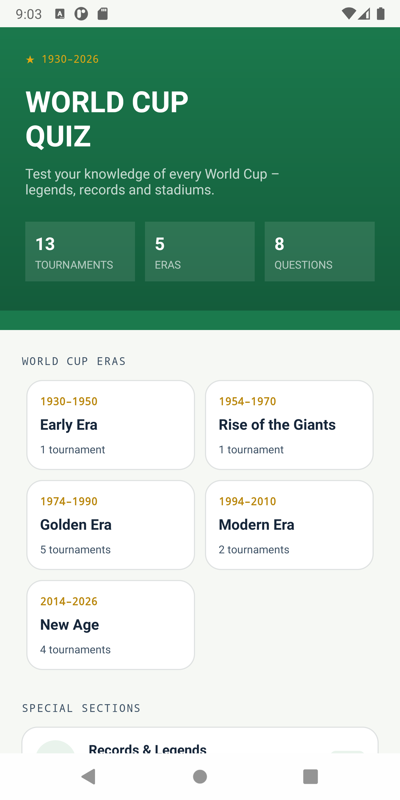

# World Cup Quiz ⚽

An Android quiz app about the history of the FIFA World Cup (1930–2026),
built in Java as a learning project.

## Features

- **Quizzes by era** – five eras of World Cup history, with topic filters
  (All / Finals / Players / Records)
- **Records & Legends** – a cross-era quiz
- **Answer feedback** – correct answers turn green, wrong ones red
- **Timer and progress bar**
- **Resume quiz** – leave a quiz halfway and continue later from the same question
- **Results screen** – score, accuracy, time and points
- **Stadiums** – facts about World Cup venues
- Works fully **offline** (local Room database)

## Tech stack

| | |
|---|---|
| Language | Java 17 |
| Min / target SDK | 24 / 36 |
| Architecture | MVVM (Fragment → ViewModel → Repository → DAO) |
| Database | Room |
| Reactive data | LiveData |
| Navigation | Navigation Component + Safe Args |
| UI | XML layouts, ViewBinding, Material 3, RecyclerView |

## Project structure

```
com.nemo.worldcupquiz
├── data
│   ├── local          # Room: AppDatabase, DatabaseSeeder
│   │   ├── dao        # SQL queries
│   │   └── entity     # tables: Tournament, Question, Stadium...
│   ├── model          # enums: Era, CategoryType
│   └── repository     # single source of data for ViewModels
├── ui
│   ├── home, category, quiz, results, stadiums
│   └── model          # UI-only models
├── util               # AppExecutors (background threads)
├── MainActivity       # hosts the navigation graph
└── WorldCupQuizApp    # Application class
```

## Getting started

1. Clone the repository
   ```
   git clone https://github.com/NemanjaAdzic83/WorldCupQuiz.git
   
   ```
2. Open the project in Android Studio
3. Run it on an emulator or a device (Android 7.0+)

## Screenshots

<!-- Add screenshots here, e.g.  -->

## Notes

Mascot artwork and stadium photos are not included because they are
copyrighted. The app shows placeholders instead.

## Author

**Nemanja Adžić** – [@NemanjaAdzic83](https://github.com/NemanjaAdzic83)